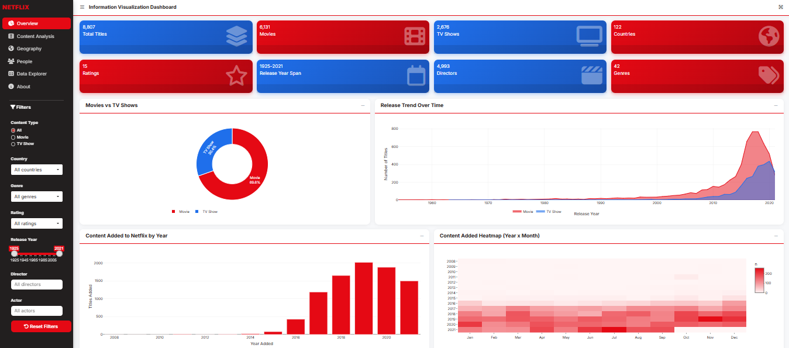

# Netflix Information Visualization Dashboard

An interactive dashboard exploring the Netflix catalogue (8,807 titles) and how it
changed over time — built entirely in **R Shiny**.



## Features

- **6 tabs** — Overview · Content Analysis · Geography · People · Data Explorer · About
- **13 coordinated visualizations** including an **animated, rotatable globe** that
  replays the catalogue's global growth year by year
- **7 global filters** (type, country, genre, rating, release year, director, actor) —
  every chart, KPI card and table reacts to the same filtered dataset
- **Data Explorer** with search, column filters, sorting and CSV/Excel export
- Netflix-themed custom UI (white canvas, red/blue encoding, rounded cards)

## Key findings

~70% of the catalogue are movies, but TV's share of new additions grows every year
after 2016. Content comes from 120+ countries (US, India, UK leading). Additions
peaked in 2019 at ~2,000 titles in a single year. TV-MA and TV-14 cover ~60% of
all titles.

## Run it

```r
install.packages(c("shiny", "bs4Dash", "plotly", "ggplot2", "DT",
                   "dplyr", "tidyr", "stringr", "shinyWidgets"))
shiny::runApp("netflix-dashboard")
```

Dataset: [Netflix Movies and TV Shows (Kaggle)](https://www.kaggle.com/datasets/shivamb/netflix-shows) —
place `netflix_titles.csv` next to `app.R`. Without it the app runs on a small
generated demo dataset.

## Demo

🎥 [Video walkthrough](https://youtu.be/RRC0SwO1xbo)

## Author

**Sami Al Jaber Tasin** — MSc Data Science, University of Primorska
Course project for Information Visualization (UP FAMNIT)